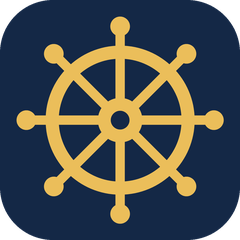
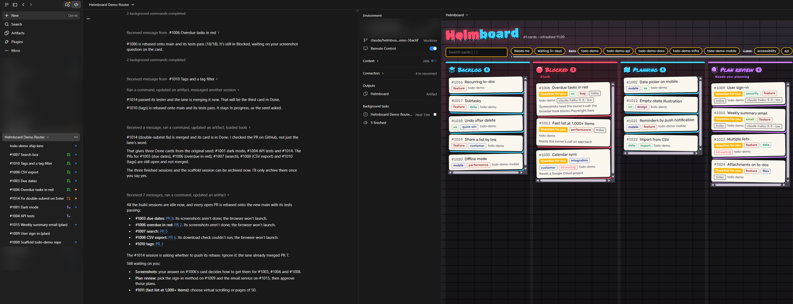
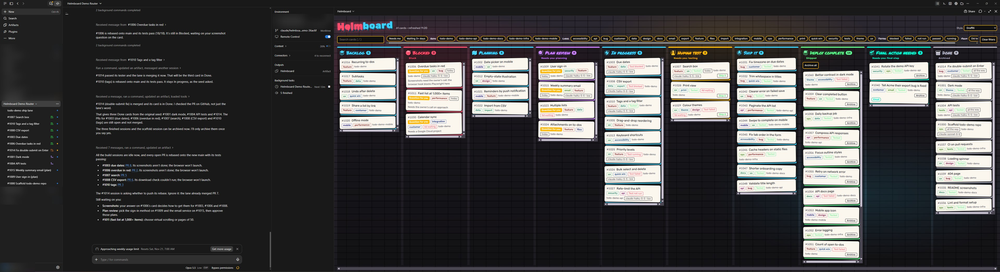
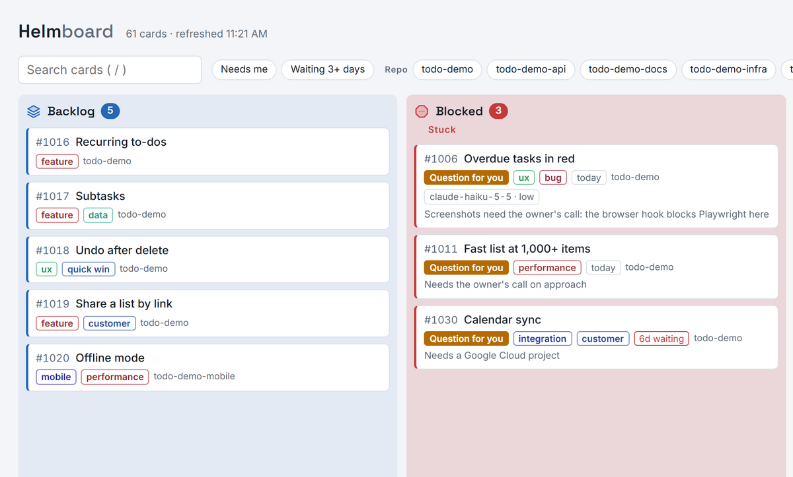
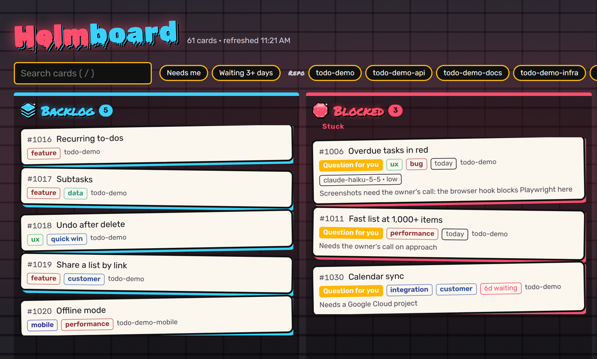
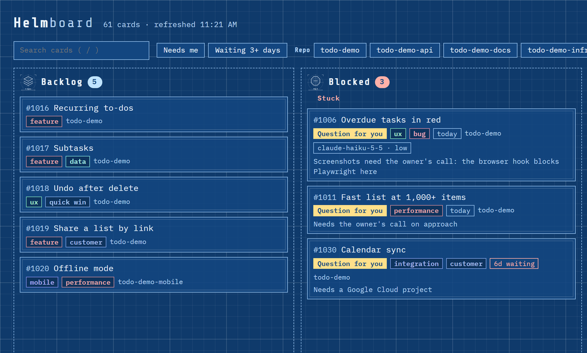
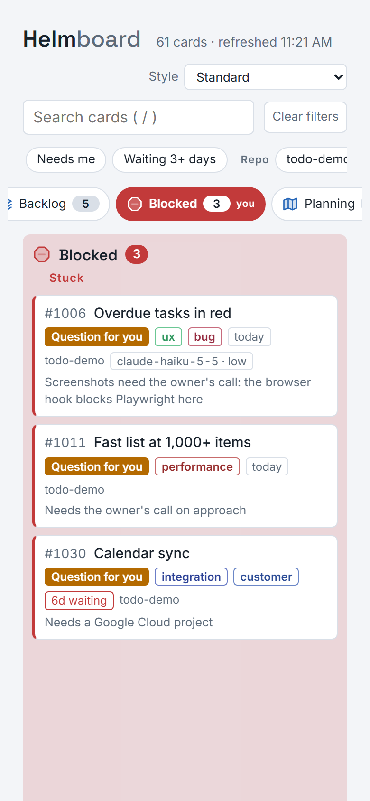
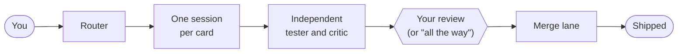

<p align="center"></p>

<h1 align="center">Helmboard</h1>

<p align="center"><strong>A visual board and GUI for Claude Code. Take the helm of every session.</strong></p>

<p align="center">
  <a href="LICENSE"></a>
  
  
</p>

<p align="center">
  <a href="#install">Install</a> ·
  <a href="#features">Features</a> ·
  <a href="#see-it-in-the-app">Screenshots</a> ·
  <a href="#faq">FAQ</a>
</p>

**To install, copy this into Claude Code:**

```
Install https://github.com/hughht5/helmboard
```

<p align="center">
  <a href="docs/desktop-app.png"></a><br>
  <sub>The Router's sessions, its chat and the board, side by side in the Claude desktop app.</sub>
</p>

Helmboard is a Claude Code dashboard for pro vibe coders who want less terminal: one board to see, steer and ship every session.

**Talk to one Claude Code session. It runs all the others.**

- Tell it what you want, in plain words.
- It makes a card for each task and starts a separate session to build it.
- An independent tester checks the work, and a critic reviews it.
- A merge lane ships finished work one card at a time, so your sessions never fight over the same code.
- You watch it all on a live board.

**By default, you stay in control.** Big or risky tasks get a plan first. You approve it, or answer its questions with one click on the card. You test the result, then say "ship it".

**Or let it run.** Say "take it all the way" and it plans, builds, tests and ships on its own, skipping the human checks. It still won't ship anything that fails its tests.

## Install

Paste this into Claude Code (desktop app or terminal, macOS or Windows):

```
Install https://github.com/hughht5/helmboard
```

That's it. Claude follows [INSTALL.md](INSTALL.md), checks you have git, Node and the GitHub CLI (and offers to install them), and sets everything up. Then open a new session and send `/helmboard-start`. To update later, say "Update Helmboard".

<details><summary>Prefer a plugin? (terminal)</summary>

Run these one at a time:

```
/plugin marketplace add hughht5/helmboard
```
```
/plugin install helmboard@helmboard
```
```
/helmboard-start
```
</details>

## Features

| | |
|---|---|
| 📋 **Live board**<br>Every task is a card on a private board that moves as the work does. | 🌿 **One session per task**<br>Each card gets its own Claude Code session, in its own worktree and branch. |
| 🧪 **Independent tester and critic**<br>A separate tester runs every check and leaves evidence before you see it. | 🚦 **Plans first, your gates**<br>Each card is planned before building; you approve the plan or answer its questions on the card, test it, and say when it ships. |
| 🚢 **Merge lanes**<br>Approved cards ship one at a time per repo, so parallel work never collides. | 🗂️ **Many repos, one board**<br>One Router runs cards across all your repos, with a lane for each. |

Why: running five or ten agent sessions by hand means losing track of which is stuck, which drifted, and which two are about to merge over each other.

## See it in the app

<p align="center">
  <a href="docs/board.png"></a><br>
  <sub>Every task is a card. The board shows which ones need you.</sub>
</p>

## Made for ultra-wide screens

Helmboard uses every pixel. On a 5120-wide monitor you get the Router chat, your sessions and every column of the board on one screen, with no scrolling and nothing hidden. You can see the whole pipeline at a glance, from new ideas to shipped work.

<p align="center">
  <a href="docs/ultrawide.jpg"></a><br>
  <sub>The whole flow on one 5120x1440 screen. Click for full size.</sub>
</p>

## Pick a style

<p align="center">
  <a href="docs/style-standard.png"></a>
  <a href="docs/style-graffiti.png"></a>
  <a href="docs/style-blueprint.png"></a><br>
  <sub>Standard, Graffiti and Blueprint. Change it from the Style menu on the board.</sub>
</p>

## On your phone



The board works at phone width. Open its link on your phone while the Router runs on your computer.

- One column at a time. Swipe, or tap a column's name, to move between them.
- Columns that need you are marked "you", so you can check cards at a glance.
- Tap a card to open it, then answer its question with one tap.
- Approve a plan, send it back, or ship a tested card with the same buttons as on desktop.

<br clear="right">

---

## What you need

Works on macOS and Windows. You need:

- The Claude desktop app, with Claude Code.
- A claude.ai account that can publish artifacts (the board page).
- Node.js and git installed, and GitHub's `gh` signed in. If you're not signed in, run `gh auth login` yourself.

Missing something? Ask Claude: "Check I have everything Helmboard needs and fix what's missing."

## Quick start

1. Install as above and run `/helmboard-start`. That session is your Router. Keep that session open.
2. Tell it what you want: "fix the login bug", "add dark mode". It makes a card and gets on with it.
3. Watch the board. You approve plans, test the result, and say "ship it".
4. In any other session, say "tell the router" to hand that task over.

Handy phrases: "what's next?", "ship it", "take it all the way".

## How it works



1. You tell the Router a task. It makes a card and starts a session for it.
2. Big or risky tasks get a plan first, and wait for you to approve it.
3. A separate tester checks the work and leaves evidence. A critic reviews it.
4. The card waits for you to test it. Say "ship it" and its repo's merge lane sends it out. Say "take it all the way" up front to skip the waiting.
5. Every 15 minutes the Router checks for stuck or drifting sessions. Each mistake becomes a permanent rule, so it doesn't repeat.

## Make it yours

Everything is changed by asking. Tell the Router what you want and it edits the board, its rules and its checks itself.

- Columns: "Add a Design review column before Human test."
- Repos: "Work in my other repo too."
- Rules for one project: "Never touch the billing folder in this repo."
- Pace: "Stop asking me to approve plans for small changes."
- Models and cost: "Use cheaper models wherever you can."

## FAQ

<details>
<summary>Ten common questions</summary>

**Does it need the desktop app?** Yes.

**Is the board public?** No, it's private to you. Don't share it: a comment on it can approve a ship.

**Not on GitHub?** Ask Claude: "Adapt Helmboard to GitLab" (or "to work without a remote"). It follows [ADAPTING.md](ADAPTING.md). Untested so far.

**Can it merge or deploy without me?** Not unless you say "take it all the way". Otherwise it stops and waits for your say-so.

**Where does my data live?** In a folder on your machine that you own. Ask: "Where is my board stored, and can you back it up?"

**Can I use my own columns or repos?** Yes. Ask the Router: "add a Design review column", "work in my other repo too". It changes the board and its own rules.

**Something looks stuck or wrong.** Ask: "Router, what's stuck and why?" or "The board looks out of date, fix it."

**Can I run more than one Router, or keep projects apart?** Yes. Ask: "Set up a separate Router for my side project."

**What does it cost?** Each card is its own session. The Router uses cheap models for routine work and your own model for code and plans. Ask: "What have my cards cost so far?"

**How do I update or remove it?** Ask: "Update Helmboard to the latest version" or "Remove Helmboard cleanly."

</details>

<details>
<summary>How it works under the hood</summary>

- Skills: `helmboard-start` (the Router) and `tell-helmboard` (hand-off from other sessions), in `skills/`. The plugin manifest is in `.claude-plugin/`.
- Board: `board/board.html`, published as a private artifact. Cards are kept in your board folder (`~/helmboard`), which is a git repo.
- Rules: `board/brief-rules.md` goes into every session the Router starts.
- Merge lanes: one session per repo ships approved cards one at a time.
- Hooks (`hooks/`, registered by `hooks/hooks.json`): stop non-lane sessions merging to `main`, keep cards and lane queues consistent, restore the Router's context after a compaction, and refuse launching a browser from the shell. They only act in the Router's own session.

</details>

## What Helmboard does on your machine

<details>
<summary>What it publishes, runs, reads and sends</summary>

Helmboard runs inside Claude Code with your permissions. In plain words, it:

- **Publishes your board as a private claude.ai Artifact** (`board/board.html`) and writes card data to that artifact's database with Claude's `Artifact` and `ArtifactData` tools. The board stays private unless you share it. The page loads fonts from Google Fonts and pinned Chart.js and Mermaid files from cdnjs.
- **Starts, messages and stops Claude Code sessions** for you (one per task, plus one merge lane per repo), through the Claude desktop app's session tools. `tell-helmboard` sends a message from another session to your Router.
- **Reads and writes the `~/helmboard` folder** (or `HELMBOARD_DIR`): cards, rules, lane queues, locks and `router.json`. It runs `git init` and `git commit` there to keep a history.
- **Runs `git` and `gh` on your repos** through the sessions it starts: branches, commits, pushes, merges to `main` by a merge lane after your approval, and `gh pr view` and CI status checks on GitHub.
- **Runs scheduled checks** on its own cards and session usage while the Router is running.
- **Runs four hooks** (Node.js scripts in `hooks/`), which read local files only and make no network calls:
  - `block-shell-browser.js` (before a shell command): refuses commands that launch Edge or Chrome from the shell.
  - `router-merge-guard.js` (before a shell command): stops the Router's sessions other than a merge lane merging or pushing to `main`; sessions it didn't start are never blocked.
  - `router-cards-check.js` (when a turn ends): refuses to end the Router's turn while a card's column contradicts the lane queues.
  - `router-postcompact.js` (on resume or after a compaction): feeds the Router its saved state from `~/helmboard`.
- **Sends nothing anywhere else.** No telemetry, no analytics, no servers of its own. The only network traffic is Claude Code's own, GitHub through your `git` and `gh`, and the board page's font and library loads above.

</details>

## Licence

MIT. See `LICENSE`.
