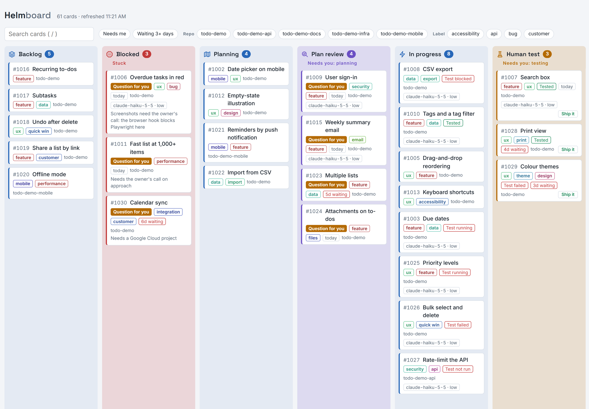

# claude-router

Talk to one Claude Code session; let it run all the others. The Router is a skill that turns
a long-running Claude Code session into a dispatcher: you hand it tasks in plain words, and it
makes a card for each, starts a separate session per task in its own worktree, has an
independent tester prove the work, stops for your review, and ships approved cards one at a
time through a per-repo merge lane. A private claude.ai artifact is the board you watch and
click. It exists because running five or ten agent sessions by hand means losing track of
which is stuck, which drifted, and which two are about to merge over each other.



## What you need first

- The **Claude Code desktop app** (the Router uses its session tools to start, watch and open
  sessions, and its Artifact tools for the board).
- A **claude.ai account** that can publish artifacts, for the board page.
- `git`, the `gh` CLI signed in to GitHub, and Node.js (for the hooks).

## Quick start

1. **Clone** it: `git clone https://github.com/hughht5/claude-router && cd claude-router`
2. **Install the skills and hooks:**
   ```sh
   mkdir -p ~/.claude/skills ~/.claude/hooks/router
   cp -r skill/router skill/tell-router ~/.claude/skills/
   cp hooks/*.js ~/.claude/hooks/router/
   ```
3. **Make your board folder** from the template and put it under git:
   ```sh
   cp -r board ~/router-board && cd ~/router-board && git init && git add -A && git commit -m "Empty board"
   ```
4. **Add the hooks** to `~/.claude/settings.json`: merge the `hooks` block from
   `settings.example.json` into yours (don't replace your file).
5. **Start it:** open a new session in the desktop app and type `/router`. On first run it
   publishes `board.html` as a private artifact, saves the link in `router.json`, and opens
   an empty board beside you. Then give it a task.

## The parts

| Part | Where | What it does |
|---|---|---|
| Router skill | `skill/router/SKILL.md` | How the Router behaves: cards, briefs, models, testing, review gates, watching for stuck or drifting sessions, shipping. |
| tell-router skill | `skill/tell-router/SKILL.md` | Lets any other session hand a task to the Router with a full brief. |
| Board artifact | `board/board.html` | The board: columns, card faces, full view, Plan tab, questions with answer buttons, an "Ask the Router" box. Cards live in the artifact's database; `cards.json` is the record it can be rebuilt from. |
| Session rules | `board/brief-rules.md` | Pasted into every session the Router starts. One line per thing that once went wrong. |
| Plan schema | `board/plan-fields.md` | The fields the Plan tab draws. |
| Merge lanes | `board/lane/` | One lane session per repo ships approved cards strictly in queue order: rebase, settle the version and changelog, test, merge, watch the deploy. `board-queue.md` does the same for changes to the board page itself. |
| Locks | `board/locks/` | File locks for shared test state: test personas, organisation settings, dev-stack ports, the board page. |
| Scheduled check | `board/check-prompt.md` | The prompt the Router runs every 15 minutes to audit cards and catch stuck or drifting sessions. |
| Hooks | `hooks/` | Blocks that words in a brief can't guarantee (below). |

### Hooks

| Hook | Event | Does |
|---|---|---|
| `router-merge-guard.js` | PreToolUse (Bash, PowerShell) | Among the Router's sessions (listed in `lane/guard.json`), only a lane may merge a PR or push `main`. Your own sessions are never blocked. |
| `router-cards-check.js` | Stop | The Router can't end a turn while `cards.json` disagrees with a lane queue. |
| `router-postcompact.js` | SessionStart (compact, resume) | After a compaction, feeds the Router its handover, standing instructions, lane queues and skill. |
| `block-shell-browser.js` | PreToolUse (Bash, PowerShell) | Refuses launching Edge or Chrome from the shell (use Playwright or Claude in Chrome). |

Paths: the hooks read `ROUTER_DIR` (default `~/router-board`) and `ROUTER_SKILL` (default
`~/.claude/skills/router/SKILL.md`), in `hooks/config.js`. Keep `config.js` beside the hooks.
The Router-only hooks act only in the session named in `router.json`, so they are safe to
install globally.

Example `settings.json` snippet (the whole of `settings.example.json`, one event shown):

```json
{
  "hooks": {
    "PreToolUse": [
      {
        "matcher": "Bash|PowerShell",
        "hooks": [
          { "type": "command", "command": "node \"$HOME/.claude/hooks/router/block-shell-browser.js\"", "timeout": 10 },
          { "type": "command", "command": "node \"$HOME/.claude/hooks/router/router-merge-guard.js\"", "timeout": 10 }
        ]
      }
    ]
  }
}
```

On Windows, if `$HOME` doesn't expand in your hook shell, use the full path
(`C:/Users/<you>/.claude/hooks/router/...`).

## How it works

1. You tell the Router a task. It writes a card with done-when checks and starts a session for
   it, in its own worktree and branch, with `brief-rules.md` in the brief and the cheapest
   model that fits.
2. By default the session plans if needed (stopping in **Plan review** for big or risky
   changes), builds, and runs its tests. A separate tester then runs every check and leaves
   evidence: a numbered, captioned screenshot story for anything with a screen.
3. The card stops in **Human test** with steps to try. You test, then say "ship it" (or click
   on the board). Say "all the way" up front to skip the stop.
4. The Router queues the card in that repo's lane. The lane ships cards one at a time, so
   parallel work never collides at merge, and stops the line if a deploy goes red.
5. Every 15 minutes the Router checks each running session for being stuck or drifting off its
   card, and keeps every card in the right column. Each mistake becomes a permanent rule: a
   hook, a test, or a line in `brief-rules.md` and `lessons.md`.

## FAQ

**Does it need the desktop app?** Yes. The Router starts, watches and opens other sessions with
the desktop app's session tools; the plain CLI doesn't have them.

**Is the board public?** No. Artifacts are private to you unless you share them. Don't share
it: a comment on it can approve a ship for the card it names.

**Can it merge or deploy without me?** Not on a default task. It stops in Human test, and the
merge-guard hook blocks merges and pushes to `main` from every session it started except the
lane. Only "all the way", said by you, lets a card go through.

**Where does my data live?** In your board folder (`~/router-board`, a git repo you own) and in
the artifact's database. `cards.json` can rebuild the board if the page is ever lost.

**Can I use my own columns or repos?** Repos, yes: lanes are made per repo on first ship.
Columns are the ones in the skill's table; changing them means editing `board.html` and the skill.

**What does it cost?** Each card is its own session. The Router picks cheap models for docs,
reviews, testers and lanes, and your own model only for code and plans.

## Licence

MIT. See `LICENSE`.
